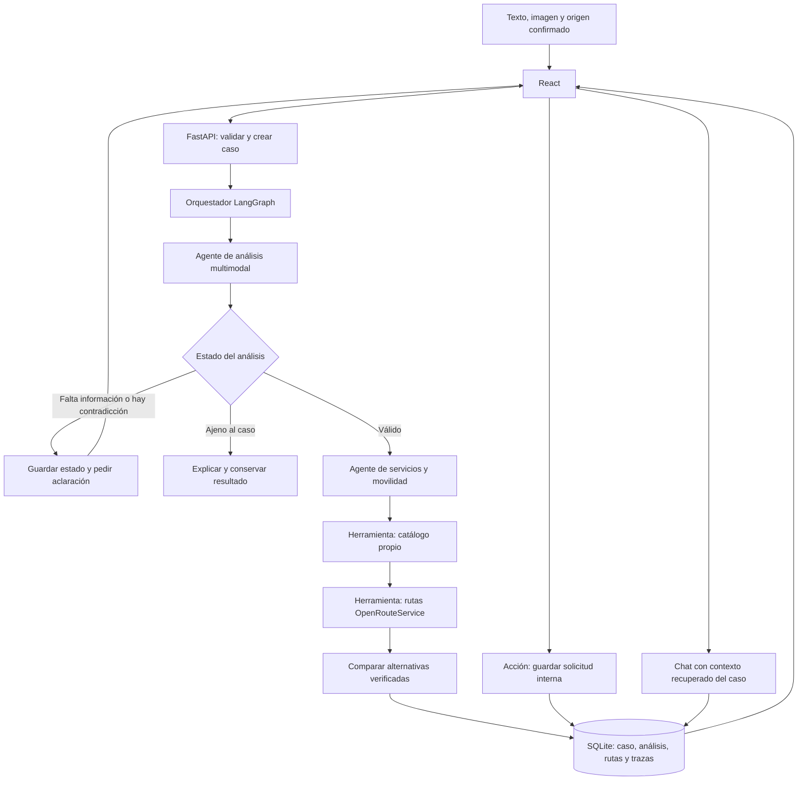

# BiciAyuda Bogotá — Diseño de la solución

Estado: diseño para implementación. Este documento no acredita funcionalidades ya implementadas.
Actividad entregable — Unidad III. Sustentación: 17 de octubre de 2026.

## 1. Problema, usuarios y alcance

Ayudar a ciclistas en Bogotá a encontrar servicios de reparación o asistencia a partir de una descripción, una imagen y un origen geográfico confirmado. La aplicación interpreta la necesidad, consulta un catálogo propio, obtiene rutas reales mediante un proveedor externo y permite guardar una solicitud interna de asistencia.

Primera versión: pinchazos, frenos, transmisión, mantenimiento y necesidad no determinada. Tres alternativas como máximo. No se afirmarán diagnósticos definitivos basados solo en fotografías. La solicitud es un registro dentro de BiciAyuda: no representa una reserva ni un envío a un taller.

Los registros del catálogo incluirán su procedencia y fecha de verificación. Los registros ficticios se marcarán como demostración en todas las pantallas. El cálculo externo de una ruta no convierte un negocio ficticio en uno verificado. La entrega debe incluir registros reales verificados para demostrar recomendaciones de servicios reales; no se inventarán teléfonos, horarios, precios ni disponibilidad.

## 2. Tecnologías y decisiones

| Componente | Decisión y función |
|---|---|
| Interfaz | React + Vite; formulario, selección de origen, resultados, chat, historial y trazas |
| Backend | FastAPI; validación, casos, coordinación, herramientas y acciones |
| IA | Adaptador google-genai; GEMINI_MODEL configurable; candidato gemini-2.5-flash para texto, imagen, JSON y chat |
| Contratos | Pydantic; respuestas y entradas validadas |
| Agentes | Dos componentes con herramientas y resultados distintos, coordinados por LangGraph |
| Geografía | OpenRouteService Directions, consumido desde el backend con clave privada |
| Persistencia | SQLite con claves foráneas y ruta absoluta configurada |
| Pruebas | pytest para flujo, datos y contratos; servicios simulados solo en pruebas explícitas |

El modelo candidato soporta entradas de texto e imagen y salidas estructuradas según su documentación. Su disponibilidad con la cuenta y clave del grupo debe verificarse antes de la demostración. El README final registrará el modelo efectivamente probado, latencia observada, límites aplicables y costo consultado; no se asumirán cuotas gratuitas.

El origen se obtiene mediante geolocalización del navegador o ingreso manual de coordenadas. Siempre se confirma y puede corregirse. Esto evita añadir un segundo proveedor de geocodificación al alcance inicial. La denegación del permiso de ubicación no bloquea el formulario.

OpenRouteService entrega rutas y magnitudes geográficas; no será la fuente del catálogo de talleres. Se usará inicialmente el perfil peatonal para desplazarse con la bicicleta. Una ruta del proveedor no certifica seguridad, transitabilidad actual ni acceso con bicicleta a cada tramo. El usuario confirma su modo de desplazamiento; no se infiere que puede pedalear por la apariencia de una foto.

## 3. Arquitectura y flujo



1. El backend valida descripción, archivo y coordenadas; crea un identificador estable de caso y registra el inicio.
2. El agente de análisis interpreta texto e imagen y entrega un objeto validado.
3. Si la entrada es insuficiente, contradictoria o ajena al caso, el orquestador detiene la búsqueda y guarda el motivo. Una aclaración crea una nueva revisión del mismo caso.
4. Con información válida, el agente de servicios consulta categorías y lugares del catálogo; descarta categorías incompatibles y preselecciona cercanos por distancia en línea recta.
5. Consulta rutas reales para hasta tres candidatos. La cercanía calculada localmente no se mostrará como distancia de recorrido.
6. Ordena por compatibilidad del servicio y después por distancia de ruta. Conserva proveedor, fecha y advertencias; la IA solo explica los datos obtenidos.
7. Guarda resultados y eventos antes de devolver la recomendación.
8. El usuario elige un servicio y guarda una solicitud interna. La transacción y su evento quedan asociados al caso y a su revisión.
9. El historial recupera los mismos resultados tras reiniciar el backend. El chat recibe el caso guardado, alternativas, acción y mensajes previos.

Si falla Gemini, se conserva el caso con error y opción de reintento. Si falla el servicio geográfico, se conserva un resultado parcial con el error: no se inventan rutas ni tiempos y no se etiqueta la ejecución como completa. Si no hay candidatos, se informa sin inventar negocios.

## 4. Agentes y herramientas

| Componente | Recibe | Herramientas | Produce |
|---|---|---|---|
| Agente de análisis | Texto, imagen, origen, aclaraciones y categorías admitidas | Modelo multimodal y catálogo de categorías | Estado de validez, evidencia, categoría, contradicciones y preguntas |
| Agente de servicios y movilidad | Análisis válido, origen confirmado y preferencias | buscar_servicios_propios y calcular_ruta | Alternativas, rutas, orden y razones respaldadas por datos |
| Orquestador | Estado persistido y revisión del caso | Ejecución de nodos, transiciones y repositorio | Siguiente paso, resultado parcial/completo y eventos |

El agente de servicios controla un ciclo de consulta, comprobación de cobertura y obtención de rutas; no se limitará a un segundo prompt. Cada herramienta tiene contrato, resultados y fallos registrados. Las transiciones condicionales se demostrarán con casos válidos e insuficientes.

- consultar_categorias(): categorías y descripciones admitidas desde datos propios.
- buscar_servicios_propios(categoria, origen, limite): consulta SQLite y devuelve identificadores, coordenadas, servicios y procedencia.
- calcular_ruta(origen, destino, perfil): consulta OpenRouteService y devuelve distancia en metros, duración en segundos, geometría, proveedor y fecha.
- guardar_solicitud(caso_id, revision, servicio_id, clave_idempotencia): acción transaccional iniciada por el usuario; comprueba que el servicio pertenece a las alternativas guardadas y evita duplicados por reintento.

## 5. Contrato de análisis

```json
{
  "estado": "requiere_aclaracion",
  "necesidad": "Revisar una posible pérdida de aire",
  "categoria_servicio": "pinchazo",
  "observaciones_imagen": ["La imagen permite ver una rueda, pero no confirmar una perforación"],
  "hechos_reportados": ["El usuario indica que la llanta pierde aire"],
  "hipotesis": ["Podría existir una fuga; requiere revisión presencial"],
  "contradicciones": [],
  "informacion_faltante": ["Confirmar si puede desplazarse caminando con la bicicleta"],
  "preguntas_aclaracion": ["¿Puedes caminar llevando la bicicleta?"],
  "advertencias": ["La fotografía no confirma la causa de la pérdida de aire"]
}
```

Estados admitidos: valido, requiere_aclaracion, contradictorio, fuera_de_alcance. Categoría: un identificador del catálogo o null. No se usarán porcentajes de confianza inventados. El origen confirmado proviene del formulario y se valida por separado; el modelo no puede reemplazarlo por coordenadas inferidas de la imagen.

## 6. Persistencia y trazabilidad

| Tabla | Contenido mínimo |
|---|---|
| categorias | Identificador, nombre y descripción |
| servicios | Nombre, categorías, coordenadas, dirección, procedencia, verificado_en y es_demo |
| casos | UUID, descripción, origen, estado, revisión y fechas |
| evidencias | Caso, revisión, ruta interna del archivo, MIME validado y hash |
| analisis | Caso, revisión, esquema JSON validado, modelo y fecha |
| alternativas | Caso, revisión, servicio, orden, motivo, ruta, proveedor y fecha de consulta |
| solicitudes | Caso, revisión, servicio, estado, fecha y clave de idempotencia única |
| mensajes | Caso, rol, contenido y fecha |
| eventos | Caso, revisión, correlación, agente/herramienta, inicio, fin, estado y resumen de entrada/salida |

Las trazas guardarán evidencias operativas resumidas, no claves ni razonamientos privados del modelo. Ejemplo: agente_servicios inició; buscar_servicios_propios devolvió 3 registros; calcular_ruta respondió para 2 y falló para 1; recomendación guardada; solicitud SOL-001 creada.

Editar la descripción u origen requiere nueva revisión; resultados anteriores no se mezclarán con los datos editados. Los casos se consultan por identificador y el backend recupera el contexto: el navegador no suministra un análisis arbitrario como fuente de verdad.

## 7. API prevista

| Ruta | Función |
|---|---|
| GET /api/health | Estado del backend; sin afirmar disponibilidad externa no comprobada |
| GET /api/categorias | Catálogo de categorías |
| POST /api/casos | Crear caso con texto, imagen y origen; ejecutar análisis y búsqueda |
| GET /api/casos | Historial resumido |
| GET /api/casos/{id} | Recuperar análisis, alternativas y solicitudes |
| POST /api/casos/{id}/aclaraciones | Guardar aclaración y ejecutar una revisión |
| POST /api/casos/{id}/mensajes | Chat contextual con historial persistido |
| POST /api/casos/{id}/solicitudes | Registrar una solicitud interna sobre una alternativa válida |
| GET /api/casos/{id}/trazas | Recuperar participación de agentes y herramientas |

Se validarán archivos JPEG/PNG/WEBP con máximo inicial de 5 MB, contenido decodificable y nombres internos generados. Errores de proveedor, validación y límites tendrán estados HTTP y mensajes diferenciados. Claves solo en backend; CORS y URL de API configurables.

## 8. Pantallas

1. Nuevo caso: descripción, evidencia, ubicación confirmable y modo de desplazamiento.
2. Aclaración: lo detectado, qué falta y campo de respuesta.
3. Resultado: observaciones, advertencias, alternativas y distancia/tiempo consultados; etiquetas visibles de datos de demostración si aplican.
4. Detalle: geometría de ruta o enlace geográfico, fuente, fecha y botón Guardar solicitud.
5. Chat del caso: preguntas sobre evidencia, alternativas y solicitud.
6. Historial: recuperar un caso con su análisis, solicitud y trazas.

## 9. Correspondencia con las siete fases

| Fase | Implementación prevista | Evidencia de aceptación |
|---|---|---|
| 1. Diseño | Este alcance, contratos y componentes | Arquitectura coincide con el código y README final |
| 2. Multimodalidad | Texto + imagen y JSON validado | Dos imágenes distintas; caso insuficiente, contradictorio y ajeno |
| 3. Datos y geolocalización | Catálogo propio y Directions externo | Servicio con procedencia y respuesta geográfica real |
| 4. Herramientas y acción | Consulta SQL, ruta y solicitud | Trazas de consultas y registro recuperable de la acción |
| 5. Chat contextual | Caso guardado, resultados y mensajes | Preguntas sucesivas y reconocimiento de datos desconocidos |
| 6. Agentes | Dos responsabilidades y grafo condicional | Ejecuciones con agentes distintos y rama de aclaración |
| 7. Persistencia | Caso, análisis, alternativas, acción y eventos | Reiniciar backend y recuperar todos los resultados |

## 10. Orden de implementación y pruebas

1. Estructura nueva independiente del ejemplo, configuración, dependencias y SQLite.
2. Catálogo con procedencia y herramientas de consulta/rutas.
3. Contratos multimodales y agente de análisis.
4. Agente de servicios y orquestación condicional con eventos.
5. Persistencia íntegra, solicitudes e historial.
6. Interfaz y chat contextual.
7. Pruebas de flujo normal, aclaración, contradicción, imagen ajena, proveedor fallido, catálogo vacío, reinicio y solicitud duplicada.
8. Verificación en vivo con credenciales del grupo; README, .env.example y entrega GitHub.

Configuración prevista: GEMINI_API_KEY, GEMINI_MODEL, ORS_API_KEY, DATABASE_PATH, UPLOAD_DIR, CORS_ORIGINS y VITE_API_BASE_URL. Valores secretos vacíos o de ejemplo en el repositorio. No reutilizar las credenciales incluidas en el archivo de referencia.

## 11. Guion de sustentación

Crear un caso con imagen de bicicleta y origen en Bogotá; mostrar el JSON y las alternativas con ruta externa. Preguntar por qué se eligió una opción y luego por un dato ausente como un precio. Guardar una solicitud, reiniciar y recuperar caso, análisis, solicitud y trazas. Repetir con una entrada insuficiente para evidenciar la decisión del orquestador.

La maqueta y los servicios simulados no acreditan integración real. Las claves de Gemini y OpenRouteService y registros verificados del catálogo son requisitos pendientes para la demostración en vivo.

## 12. Fuentes técnicas

- Gemini 2.5 Flash: https://ai.google.dev/gemini-api/docs/models/gemini-2.5-flash
- OpenRouteService, documentación de API y autorización: https://openrouteservice.org/dev/
- OpenRouteService, obtención de clave: https://openrouteservice.org/log-in/

Estas fuentes sustentan la elección técnica; no equivalen a una prueba de disponibilidad con la cuenta del grupo.
