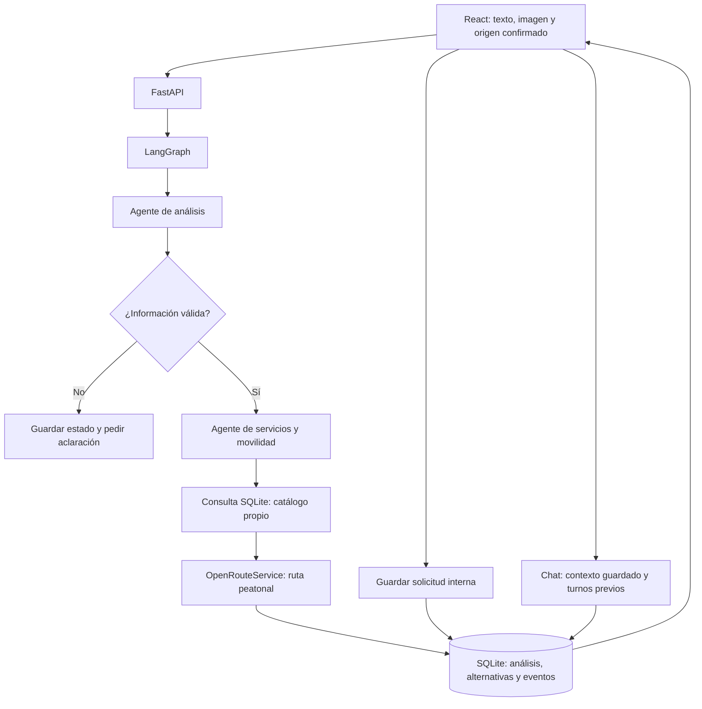

# BiciAyuda Bogotá

Asistencia para ciclistas: describe una necesidad, adjunta una imagen y confirma el origen. La aplicación analiza el caso, consulta un catálogo propio, compara alternativas y permite guardar una solicitud interna. Incluye chat, historial, revisiones y trazabilidad.

Proyecto nuevo e independiente del ejemplo de incidentes tecnológicos. Actividad entregable y experiencial — Unidad III.

## Estado real de la entrega

- React y FastAPI implementados; dos agentes coordinados mediante LangGraph.
- SQLite conserva evidencia, análisis JSON, alternativas, revisiones, chat, solicitudes y eventos.
- Modo demostración operativo sin claves: reglas de texto, tres lugares ficticios y líneas rectas ilustrativas. **No interpreta visualmente la imagen ni consulta una API externa.** La interfaz muestra esta limitación.
- Modo conectado implementado con Gemini y OpenRouteService. Requiere claves propias y acceso al modelo. No se han realizado llamadas reales de validación con credenciales del grupo.
- El catálogo contiene dos registros reales para mantenimiento, revisados documentalmente en el directorio oficial de Specialized y separados de tres ejemplos ficticios. Consulta `backend/CATALOGO.md` para sus fuentes y limitaciones. Las categorías específicas de pinchazos, frenos y transmisión requieren ampliar el catálogo real; no se presume que todo taller cubra cualquier servicio.
- Aplicación local de un solo usuario para la actividad. No incluye autenticación ni aislamiento entre usuarios; no exponerla públicamente con casos o evidencias personales.
- El historial conserva hasta 100 casos en su listado; los casos siguen siendo recuperables por identificador.

## Requisitos

Python 3.11 o superior y Node.js 20.19 o superior. npm o pnpm para construir la interfaz. SQLite viene con Python. Las versiones de Python comprobadas se registran en `backend/requirements.lock.txt`; el frontend incluye `pnpm-lock.yaml`.

## Instalación y ejecución

### Inicio sencillo desde el ZIP

Extrae el ZIP completo. **No abras `frontend/index.html` ni `frontend/dist/index.html` directamente en Chrome.** Son parte de una aplicación que necesita el servidor Python.

- Windows: haz doble clic en `INICIAR-WINDOWS.bat`.
- Linux/macOS: abre una terminal en la carpeta y ejecuta `python3 iniciar.py`.

Necesitas Python 3.11 o superior. El iniciador prepara el entorno y descarga las dependencias si faltan; después abre el navegador predeterminado. Si prefieres Chrome, escribe **http://127.0.0.1:8000** en Chrome. Mantén abierta la ventana del servidor. La primera instalación necesita Internet. El ZIP ya incluye la interfaz compilada, por lo que este inicio no requiere Node.js.

`ABRIR.html` contiene las mismas instrucciones y se puede abrir con doble clic. Para comprobar una instalación existente sin abrir el navegador: `python iniciar.py --check`.

### Instalación manual y desarrollo

Desde la carpeta `biciayuda`:

```bash
python -m venv .venv
```

Activa el entorno:

```bash
# Windows PowerShell
.venv\Scripts\Activate.ps1

# Linux / macOS
source .venv/bin/activate
```

Instala las dependencias:

```bash
python -m pip install -r backend/requirements.lock.txt
cd frontend
npm install
npm run build
cd ..
python run.py
```

Abre http://127.0.0.1:8000. La interfaz compilada y el backend se sirven desde el mismo puerto. La documentación interactiva de la API está en http://127.0.0.1:8000/docs. Para detener, pulsa Ctrl+C en la terminal.

Alternativa reproducible del frontend: `pnpm install --frozen-lockfile` y `pnpm run build`. Si la versión de pnpm requiere autorización para el script de esbuild, aprueba únicamente ese paquete. No es necesario copiar los entornos virtuales ni `node_modules` a otro computador.

Para desarrollo, en dos terminales con el entorno Python activo:

```bash
# Terminal 1, desde biciayuda
python -m uvicorn main:app --app-dir backend --reload --host 127.0.0.1 --port 8000

# Terminal 2
cd frontend
npm run dev
```

Vite redirige `/api` al backend. La URL de API se puede cambiar con `frontend/.env`, usando `VITE_API_BASE_URL`; requiere volver a construir la interfaz. Las rutas de almacenamiento se resuelven respecto de `backend`, independientemente del directorio de ejecución.

## Configuración y modo conectado

Copia manualmente `backend/.env.example` como `backend/.env`. No reutilices las credenciales del proyecto de referencia ni publiques el archivo `.env`.

| Variable | Función |
|---|---|
| DEMO_MODE | `true`: simulación explícita; `false`: proveedores reales |
| GEMINI_API_KEY | Clave propia de Gemini |
| GEMINI_MODEL | Modelo con entrada de imagen y salida estructurada; candidato `gemini-2.5-flash` |
| ORS_API_KEY | Clave propia de OpenRouteService |
| DATABASE_PATH | Base SQLite, por defecto `data/biciayuda.db` |
| UPLOAD_DIR | Evidencias, por defecto `data/uploads` |
| CORS_ORIGINS | Orígenes permitidos para desarrollo |

Para activar el modo conectado: configura ambas claves, establece `DEMO_MODE=false` y reinicia. Para el catálogo real inicial, prueba una necesidad de mantenimiento general. Amplía las demás categorías mediante el importador. No hay sustitución silenciosa por datos simulados cuando falla un proveedor. Los casos existentes conservan su modalidad original; crea uno nuevo para probar el cambio de modo.

### Catálogo propio

Los dos registros iniciales se cargan automáticamente desde `backend/catalogo.inicial.csv`. Para agregar otros, la plantilla `backend/catalogo.plantilla.csv` contiene los encabezados necesarios. Cada registro debe tener nombre, coordenadas, dirección, categorías separadas por `|`, URL de procedencia y fecha de verificación ISO. Categorías: `pinchazo`, `frenos`, `transmision`, `mantenimiento`.

Verifica manualmente los datos y la correspondencia entre nombre, dirección, coordenadas y servicio ofrecido antes de importarlos. El importador valida el formato; no certifica que el negocio exista.

```bash
cd backend
python import_catalog.py ruta/al/catalogo.csv
```

Los registros importados no se mezclan con los ficticios del modo demo. El área inicial se limita al rectángulo de coordenadas latitud 4.40–4.90 y longitud -74.30–-73.90; es un límite operativo aproximado, no el polígono administrativo de Bogotá. Se preseleccionan hasta tres servicios compatibles dentro de 20 km en línea recta.

## Arquitectura implementada



La persistencia final se organiza en `servicios`, `casos`, `revisiones`, `solicitudes`, `mensajes` y `eventos`. Para simplificar el alcance inicial, el análisis y las alternativas se guardan como JSON dentro de cada revisión; los metadatos de evidencia pertenecen al caso. El diseño previo detallado está en `ARQUITECTURA.md`; este README describe la implementación efectiva.

### Modelo y agentes

El agente de análisis consulta las categorías admitidas e interpreta texto e imagen con Gemini en modo conectado. Pydantic valida estado, necesidad, categoría, observaciones, hechos, hipótesis, contradicciones, información faltante, preguntas y advertencias. Una categoría ausente impide continuar aunque el modelo marque la entrada como válida.

El agente de servicios y movilidad recibe ese objeto; ejecuta la consulta de catálogo, descarta servicios incompatibles, solicita una ruta por candidato, maneja errores y ordena alternativas. Su responsabilidad es operativa y distinta de la interpretación visual. LangGraph conecta ambos mediante una transición condicional; las entradas insuficientes, contradictorias y ajenas al caso no ejecutan la búsqueda.

Se eligió Gemini para aprovechar texto, imagen y respuesta JSON en una misma integración. El modelo es configurable para adaptarse al acceso de la cuenta. No se ha medido latencia de producción ni confirmado el costo o la cuota del grupo; deben registrarse tras la prueba real antes de sustentar. La simulación de texto no demuestra estas capacidades.

### Geolocalización

El origen puede ingresarse manualmente o solicitarse al navegador; siempre exige confirmación. El usuario debe confirmar que puede caminar llevando la bicicleta.

La herramienta externa usa `POST /v2/directions/foot-walking/geojson` de OpenRouteService con coordenadas `[longitud, latitud]` y clave en la cabecera. Conserva distancia, duración, geometría, proveedor y momento de consulta. El orden se basa en distancia de ruta entre los candidatos preseleccionados. No se garantiza encontrar el más cercano de toda la ciudad.

La interfaz dibuja un esquema de coordenadas con la geometría recibida, sin mapa de calles. Las estimaciones no certifican seguridad actual ni acceso con bicicleta a todos los tramos. Si falla una ruta, se muestra “ruta no disponible” y el resultado es parcial; no se inventan tiempos. En demo solo se dibuja la línea recta, expresamente diferenciada.

### Acciones, chat y trazas

Guardar solicitud crea un registro SQL real, asociado al caso, revisión y servicio elegido. Una transacción evita duplicados por reintento y limita la acción a una solicitud por revisión. No contacta establecimientos ni realiza reservas.

El chat recupera el contexto del servidor y hasta 16 mensajes previos de la revisión actual. Las revisiones anteriores se conservan y están disponibles mediante la API. Las aclaraciones generan una nueva revisión, conservando las solicitudes y resultados históricos. No se permite alterar silenciosamente el texto u origen de un resultado ya guardado; un nuevo origen exige otro caso.

Las trazas registran agente/herramienta, estado, resumen, revisión y fecha. No almacenan claves ni razonamientos privados. Si falla el proveedor de IA, el caso queda conservado con un error recuperable.

## API

| Método y ruta | Función |
|---|---|
| GET /api/health | Modalidad y configuración detectada; no prueba proveedores |
| GET /api/categorias | Categorías propias |
| POST /api/casos | Texto, imagen y origen; ejecuta el grafo |
| GET /api/casos | Historial |
| GET /api/casos/{id} | Caso, análisis, alternativas, solicitudes y chat actual |
| GET /api/casos/{id}/evidencia | Evidencia validada |
| GET /api/casos/{id}/revisiones | Análisis y alternativas de todas las revisiones |
| POST /api/casos/{id}/aclaraciones | Nueva revisión y procesamiento |
| POST /api/casos/{id}/mensajes | Chat contextual |
| POST /api/casos/{id}/solicitudes | Acción interna con idempotencia |
| GET /api/casos/{id}/trazas | Eventos de todas las revisiones |

## Pruebas

```bash
cd backend
python -m pytest -q
```

La suite comprueba persistencia tras reabrir la aplicación, grafo y ramas de aclaración, entradas inválidas, límite de imagen, solicitudes duplicadas y ajenas al caso, exclusión de catálogo ficticio en modo conectado, fallos de IA/rutas y contrato de coordenadas con OpenRouteService. Los proveedores se sustituyen por dobles de prueba en los tests; estos no acreditan una llamada externa real.

## Correspondencia con las siete fases

| Fase | Evidencia implementada | Pendiente para demostrar en vivo |
|---|---|---|
| 1. Diseño | Arquitectura, frontend, backend, modelo, herramientas y agentes | Explicar decisiones usando esta documentación |
| 2. Multimodalidad | Imagen + texto a Gemini y JSON validado | Clave y ejecución real; pruebas con imágenes pertinentes y ajenas |
| 3. Datos y geolocalización | Dos servicios reales de mantenimiento con fuentes, ejemplos separados e integración Directions | Clave ORS y ampliar categorías reales si se demuestra otro tipo de necesidad |
| 4. Herramientas y acción | Consulta SQL, consulta geográfica y solicitud persistida | Mostrar consulta externa real |
| 5. Chat | Contexto del caso, resultados y mensajes previos | Probar Gemini real y preguntas sin respuesta verificable |
| 6. Agentes | Dos nodos con responsabilidades y transición condicional | Mostrar las trazas del flujo conectado |
| 7. Persistencia | Revisiones, resultados, acción y eventos | Demostrar reinicio y recuperación |

## Guion de sustentación

1. Abrir en modo conectado, con claves propias y catálogo revisado.
2. Crear un caso de mantenimiento general con foto pertinente, origen confirmado y desplazamiento a pie; para demostrar un pinchazo, incorporar primero servicios cuya categoría esté verificada.
3. Mostrar campos estructurados y rutas reales; explicar la procedencia del catálogo y la diferencia entre hipótesis y observación.
4. Preguntar por el criterio de la recomendación y por un precio no registrado; comprobar que no lo inventa.
5. Guardar una solicitud; repetir el intento para demostrar idempotencia.
6. Mostrar trazas de ambos agentes y herramientas.
7. Reiniciar backend y recuperar desde Mis casos el análisis, la solicitud y las trazas.
8. Crear un caso insuficiente o con imagen ajena y evidenciar que el orquestador no busca servicios hasta aclararlo.

No presentar el modo demo como prueba de multimodalidad o geolocalización externa.

## Entrega en GitHub

Subir esta carpeta con frontend, backend, lockfiles, README, arquitectura y ambos `.env.example`. Excluir `.venv`, `.env`, `backend/data`, `node_modules` y archivos del proyecto de referencia. No se creó ni publicó un repositorio remoto desde esta tarea.

## Documentación de proveedores

- [Gemini 2.5 Flash](https://ai.google.dev/gemini-api/docs/models/gemini-2.5-flash)
- [Salidas estructuradas de Gemini](https://ai.google.dev/gemini-api/docs/structured-output)
- [OpenRouteService API](https://openrouteservice.org/dev/)
- [Acceso y claves de OpenRouteService](https://openrouteservice.org/log-in/)

Consultar los límites, disponibilidad y precios aplicables a la cuenta utilizada antes de la sustentación.
